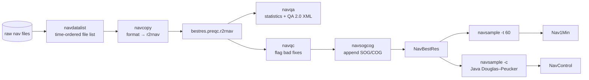
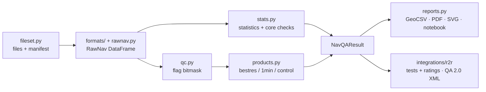

# Architecture: NavManager and its Python port

This document describes how R2R's [NavManager](https://github.com/rvdata/NavManager) is built
(last upstream commit 2025-07-02). It assesses what NavManager does well and badly, then proposes
the architecture for `nav-qa-processing`. The proposal follows the patterns already proven in
[sbe-qa-processing](https://github.com/OceanDataTools/sbe-qa-processing).

File references such as `navqc.inc.php:917` point into the NavManager repository.

---

## Part 1: NavManager today

### What it produces

From a ship's primary GPS feed, NavManager produces three R2R navigation standard products and a
quality assessment. The products are tab-separated text in the r2rnav format
(`doc/fileformat/format-r2rnav.txt`):

| Product | File | Content |
|---|---|---|
| NavBestRes | `<CRUISE>_bestres.r2rnav` | Every fix at the native rate. Bad fixes are kept, with a leading `#`. Columns: time, lon, lat, GGA quality, satellite count, HDOP, altitude, SOG [m/s], COG [°] |
| Nav1Min | `<CRUISE>_1min.r2rnav` | Good fixes decimated to one per minute, with SOG and COG carried over from BestRes |
| NavControl | `<CRUISE>_control.r2rnav` | Douglas–Peucker control points: time, lon, lat |

The QA output is a statistics object, written as text, JSON and an R2R QA 2.0 XML
`certificate`.

### Runtime and layout

- PHP ≥5.2 command line scripts in `bin/`. Each one is a thin `getopts` wrapper around a library
  in `include/*.inc.php`. You install NavManager by adding `bin/` to `PATH`.
- Java ≥1.5 for NavControl. The compiled `.class` files are committed in `include/NavControl/`.
  There is also an unwired Python port, `navsimplifier.py`.
- GMT 4 is needed only for the experimental `navplot.php`.
- Constants live in `include/globals.inc.php`:

  | Constant | Value |
  |---|---|
  | `MAX_SPEED` | 8.7 m/s |
  | `MAX_ACCEL` | 1 m/s² |
  | `MAX_GAP` | 300 s |
  | Valid GPS dates | 1994-03-01 to 2034-12-31 |

  The QC flag character is defined in `include/flags.inc.php`.
- There are no tests and no packaging. The code is roughly 20k lines of PHP, almost half of it
  in two files: `navcopy.inc.php` (4,270 lines) and `navdatalist.inc.php` (3,190 lines).

### Pipeline

The stages run as separate commands, connected by files on disk:



1. **navdatalist** reads the first and last timestamp of each raw file, using format-specific
   code. It orders the files by those timestamps and drops files outside the cruise dates. It
   reports gaps over 12 h and files it cannot parse. The **decompressor** first unpacks
   zip/gz/bz2 files into a temporary directory.
2. **navcopy** converts the ordered files into r2rnav. The caller has to name the input format
   (`-f nav1`). There is no format detection. About 37 format IDs are supported (`nav1`…`nav33`,
   `uhdas`, `siomet`, `metoc_nav`), and each is tied to the vessels and acquisition systems that
   produced it. Each format is documented in `doc/fileformat/format-*.txt`. About 15 formats are
   parsed in `include/parsers/navN.php`; the rest are inline `case` blocks in `navcopy.inc.php`.
   NMEA parsing (GGA, GLL, RMC, ZDA, VTG, plus UHDAS PYRTM and UNIXD) is in `nmeatools.inc.php`.
   GGA carries no date, so formats pair it with ZDA, RMC or a logger timestamp.
3. **navqa** makes two passes over the pre-QC file:
   - The first pass finds the modal epoch interval and the time precision.
   - The second pass counts statistics:
     - gaps, and gaps over `MAX_GAP`,
     - records out of sequence,
     - bad GGA quality indicators,
     - speeds and accelerations over their limits,
     - min/max ranges of satellite count, HDOP, altitude, speed and acceleration.

   Percent completeness is `actual countable epochs / (duration / modal interval)`.
   `xmltools2.inc.php` turns the statistics into six rated tests:

   | Test | G | Y | otherwise R |
   |---|---|---|---|
   | PercentCompleteness | ≥95 % | ≥75 % | |
   | LongestGapEpoch | ≤900 s | ≤86,400 s | |
   | PercentRecordsOutOfSequence | ≤5 % | ≤10 % | |
   | PercentRecordsWithBadQualityIndicator | ≤5 % | ≤10 % | |
   | PercentUnreasonableSpeeds | ≤5 % | ≤10 % | |
   | PercentUnreasonableAccelerations | ≤5 % | ≤10 % | |

   The overall rating is G if every test is G, R if any test is R, and Y otherwise. The certificate
   also gets infos (`TotalTests`, `GTests`, `YTests`, `RTests`) and `filesetinfo_supplemental`
   ranges (NSV, HDOP, Altitude, HorizontalSpeed, HorizontalAcceleration). Percentages are
   formatted `%0.2f` before they are compared with the thresholds.
4. **navqc** flags fixes for any of these reasons:
   - more than 30 days outside the cruise dates (or outside the valid GPS dates);
   - `00:00:00` at 0,0;
   - invalid lon or lat;
   - an invalid GGA fix: quality outside 1–5, fewer than 4 or more than 50 satellites, HDOP of 0
     or over 50 (checked only when quality and satellite count are present);
   - \|altitude\| ≥ 500 m;
   - a timestamp that isn't later than the last in-sequence one, or is more than 30 days after it;
   - identical positions while the median of the preceding 10 speeds is above 0.25 m/s, which
     catches stale repeats from loggers with uncalibrated clocks;
   - acceleration over the limit, between successive speeds (Vincenty on WGS-84): the fix
     nearest in time to the excessive acceleration is flagged. These checks run over each
     3,600-record buffer, in at most 2 iterations (the loop runs while `iter < 3` from 1).

   **Speed never flags a fix:** the speed rule (flag the fix between two speeds over the limit)
   is commented out. **The acceleration check rarely fires:** in the main buffer loop a
   "Flipped check" (2016) computes speeds only from fixes already flagged, so on clean data it
   finds nothing; only the end-of-file loop checks every pair. The acceleration limit is raised to
   3× the position resolution [m] when that is 1.11 m or more, judged from one record: a
   workaround for one vessel (Endeavor).
5. **navsogcog** appends instantaneous SOG and COG, computed from each fix to the next.
6. **navsample** decimates without interpolating: for each whole minute it takes the good record
   at that time, or else the nearer of the records either side if within half the interval. With
   `-c`, it shells out to Java `navsimplifier`, which runs Douglas–Peucker with a planar
   tolerance of 0.01° on lon/lat.

### Strengths

- **A clear product standard.** The r2rnav format, the three products and the QA tests are
  specified and documented, and R2R has applied them across the UNOLS fleet for over a decade.
  That makes them a good parity target.
- **Hard-won format knowledge.** The format documents and parsers encode the quirks of real
  acquisition systems (SCS, Calliope, UHDAS, OpenRVDAS-era loggers, DAS prefixes, comma- or
  space-delimited variants). This knowledge is the most valuable thing to carry over.
- **Field-tested QC heuristics.** NavManager handles uncalibrated clocks, duplicate positions while
  underway, null-island records, low-precision receivers, out-of-order files and >30-day
  timestamp jumps. Each one is a lesson learned from real data.
- **Preserves the receiver's precision.** It tracks the number of digits right of the decimal
  ("NROD") for time, lon, lat and HDOP, and writes values back at that precision instead of
  inventing or dropping digits.
- **Non-destructive QC.** Bad fixes are flagged with `#`, not deleted, so BestRes keeps every
  record.
- **Small, composable stages and modest memory.** Records stream through fixed buffers, and each
  stage can run and be inspected on its own.
- **Geodesically correct speeds.** It uses Vincenty on the WGS-84 ellipsoid, not a spherical
  approximation.

### Shortcomings

Every difference found while porting, with evidence from R2R's filesets and the suspected
reason, is kept in `docs/navmanager-differences.md`.

**Platform**
- PHP 5-era code. In `navqa`, `count()` is called on a scalar mode value
  (`navqa.inc.php:375`), which throws a `TypeError` on PHP ≥8.
- Compiled Java `.class` files are committed. GMT 4 is required for plots.
- No packaging, no versioning, no dependency management. Installation means editing `PATH`.
- No automated tests, so nothing guards a change against altering ratings.

**Structure**
- Format knowledge is duplicated. Each format needs a `case` in `navdatalist` (only the
  timestamps) and another in `navcopy` (the full parse), and the two can disagree. About half the
  formats are inline in a 4,270-line `switch`.
- The user has to know the format ID. Nothing detects it or reports that the wrong one was
  chosen.
- QA and QC are separate implementations of overlapping logic (navqa's 1,565 lines and navqc's
  1,233). Their speed and acceleration rules can diverge.
- QC works on fixed 3,600-record buffers. Speeds and accelerations are not evaluated across buffer
  boundaries, so which fixes get flagged depends on where the chunks fall. The end-of-file buffer
  is processed by a second, near-duplicate copy of the loop (`navqc.inc.php:917`).
- The nav29 parser dates GGAs buffer by buffer: it drops the last GGA after the final ZDA (R2R's
  SP2424 bestres lacks its final fix), drops a GGA repeating the last dated time or at 00:00:00
  before anything is dated, and moves a GGA with an equal time of day to the next day. The port
  dates each GGA from the nearest ZDA and keeps every one (#14, #15).
- navqc's speed rule is commented out, and its main-loop acceleration check is inverted (a 2016
  "Flipped check" computes speeds only from flagged fixes), so on clean data almost nothing is
  flagged; only the end-of-file loop checks every pair.
- navsogcog's full-buffer loop (86,400 records) computes each speed before calling Vincenty for
  the current pair, so it divides the previous segment's distance by the current elapsed time.
  Only the end-of-file loop is right. R2R's published SOG carries this (SP2424).
- Library functions call `exit(1)` on errors, and callers suppress warnings with `@`
  (`@navqa(...)`, `@navdatalist(...)`). Failures surface as missing output, not as messages.
- Missing values are the string `"NAN"`, and min/max use sentinels (±10000). Types are checked by
  string comparison.
- Unused globals (`DATAPATH=/data/r2r`, `SPLIT_ON_DATELINE`), commented-out algorithm variants
  and a hard-wired `$debug = true` block obscure which logic is actually live.

**Correctness**
- The NMEA reader accepts a sentence without a checksum, and a coordinate without its
  hemisphere letter is north or east. A logger that splits sentences across lines (Revelle's
  GP170, 2022–2024) therefore yields truncated fixes with missing fields as 0, some at the
  mirror-image longitude: R2R's RR2406 bestres flags 191,414 of 266,841 records and its report
  gives impossible values (653,911 % out of sequence, speeds of 14 million m s-1). The port
  rejoins split sentences and rejects truncated ones (register R5, R6, #26).
- `calcSpeedHori` checks `$lonTo == "NAN"` twice and never checks `$latTo`
  (`navtools.inc.php:176`).
- The `navqa.php` CLI takes the "ports" from the first and last records of the file it is
  assessing, so distance from port is always about 0. It also prints the start distance as the
  end distance.
- Percent completeness assumes one constant sampling rate. With several modal intervals it can
  exceed 100 %. The cookbook says to discard the value in that case, but the XML still rates it.
- The acceleration-limit inflation for low-precision receivers is silent and depends only on the
  first record's precision.
- Douglas–Peucker runs in planar degrees with a fixed 0.01° tolerance. Nothing handles the
  antimeridian beyond shifting longitudes over 180.

**Outputs**
- Without a template, `xml_write2` emits only the `certificate`: no `qareport` root, provenance or
  manifest. The full R2R report is assembled elsewhere in R2R's pipeline. The legacy
  `xmltools.inc.php` (QA 1.0) is still present.
- The rating thresholds are hard-coded twice: once in the rating `switch` and again as literal
  bound values.
- No human-readable report. The output is stdout text, JSON and XML, and the plot needs GMT.
- No OpenVDM or other shipboard integration. It is built for R2R's shore-side post-cruise
  processing.

### What R2R actually publishes today: GeoCSV

NavManager writes `.r2rnav`, but R2R no longer distributes that format. These findings come from
a released cruise: SP2613, raw GNSS fileset 169851 (Trimble BX992, format 100150 `starc_raw`), and
its product fileset 620146, both fetched 2026-10-05.

**The products are GeoCSV.** Product fileset 620146 (format 100157, `r2rnav_geocsv`, "R2R GeoCSV
Navigation") is a BagIt bag. Its manifest lists:
- `SP2613_bestres.geoCSV`
- `SP2613_1min.geoCSV`
- `SP2613_control.geoCSV`

Its `bag-info.txt` links the product back to the raw fileset (`R2R-ParentFileset: 169851`).
GeoCSV 2.0 is an IRIS/UNAVCO convention, specified in
`service.rvdata.us/docs/format_docs/100157/GeoCSV.pdf`:
- `#keyword: value` comment lines, then one CSV header line, then CSV data lines;
- lines starting with `#` are comments wherever they occur.

R2R's header block is the same for all three products, apart from the title and the columns:

```
#dataset: GeoCSV 2.0
#title: Processed Trackline Navigation Data: Best Resolution     (… One Minute Resolution / Control Points)
#field_unit: ISO_8601,degree_east,degree_north,(unitless),(unitless),(unitless),meter,meter\second,degree
#field_type: datetime,float,float,integer,integer,float,float,float,float
#field_standard_name: iso_time,ship_longitude,ship_latitude,nmea_quality,nsv,hdop,antenna_height,speed_made_good,course_made_good
#field_long_name: date and time,longitude of vessel,latitude of vessel,NMEA quality indicator,number of satellite vehicles observed,horizontal dilution of precision,height of antenna above mean sea level,course made good,speed made good
#standard_name_cv: http://www.rvdata.us/voc/fieldname
#ellipsoid: WGS-84 (EPSG:4326)
#delimiter: ,
#field_missing: NAN
#attribution: Rolling Deck to Repository (R2R) Program; http://www.rvdata.us/
#source_repository: doi:10.17616/R39C8D
#source_event: doi:10.7284/911454          (cruise DOI)
#source_dataset: doi:10.7284/169851        (raw fileset DOI)
#cruise_id: SP2613
#creation_date: 2026-07-31T20:05:56Z
iso_time,ship_longitude,ship_latitude,nmea_quality,nsv,hdop,antenna_height,speed_made_good,course_made_good
2026-07-09T15:11:57.50Z,-117.2337714755,32.7028130227,2,13,0.8,7.887,3.31,157.712
```

The data columns are the same as in r2rnav. Nav1Min has time, lon, lat, SOG and COG; NavControl has
time, lon, lat. Only the container is different.

**R2R's inconsistencies.** This project does **not** reproduce them. See "Standardized product
metadata" in Part 2.
- In bestres, `field_long_name` gives speed and course in the wrong order ("course made good,speed
  made good").
- The bestres SOG unit is `meter\second`, while 1min uses `meter/second`.
- Unit names differ between R2R products: nav uses `degree_east`, while R2R's CTD GeoCSV and the
  GeoCSV spec's own R2R example use `degrees_east`.
- The control file writes coordinates with Python's `repr` (`32.702744442`, trailing zeros
  dropped). Bestres and 1min keep fixed precision (`32.7027444420`).

**Format documentation is unreliable.** The format document `r2rnav_geocsv.txt` actually
describes Ocean Exploration Trust's tab-separated r2rnav files, not GeoCSV. The processing
description (`service.rvdata.us/docs/product/r2rnav/R2R_Navigation_DataProcessing_Description.pdf`,
v1.1) is the better reference. Its key points:
- The QA runs on the converted data before QC.
- QC flags bad points and never discards them.
- 1min takes the first valid record of each minute. (navsample actually takes the record
  nearest each minute, within half a minute.)
- Control runs Ramer–Douglas–Peucker on 1min.
- An "XML DP report" also exists, but I haven't found it online.

**NavControl comes from the Python simplifier, with the Java tolerance.** Running NavManager's
`include/NavControl/navsimplifier.py` on R2R's `SP2613_1min.geoCSV` reproduces
`SP2613_control.geoCSV` **byte for byte, including point order and number formatting**. That only
holds with the tolerance set to **0.01°**, the Java value. The script as committed uses 0.1°,
which returns 3 points instead of 5. So R2R's production simplifier is the Python one with a
locally changed tolerance.

**The raw format is OpenRVDAS-style.** Each line is an ISO 8601 logger timestamp, a comma, then the
NMEA sentence, e.g. `2026-07-09T15:11:57.510016Z,$GNGGA,…`. The sentences are GGA, GLL, HDT, VTG,
RMC and ZDA, from the GN talker. This matches NavManager's `nav29`, whose most recent upstream
commit (2025-07-02) added comma-delimited input. Product timestamps come from the GGA time plus
the ZDA date (`15:11:57.50`), not from the logger timestamp (`15:11:57.510016`). Longitudes with 8
decimal places in minutes become 10 decimal places in degrees.

**What the bestres file shows:**
- It has 56,925 records, one for every GGA in the 2026-07-09 file. The three GGAs in the
  2026-07-07 file, which is before departure, were dropped by the date window.
- No record is flagged. How a flagged record appears in GeoCSV is still unknown: GeoCSV has no
  flag column, and a leading `#` would make the line a comment.

**R2R's nav QA report.** It is at
`service.rvdata.us/data/cruise/SP2613/fileset/169851/qa/SP2613_169851_qa.2.0.2026-07-31T20:05:56Z.xml`.
That file name includes a timestamp, so it does **not** match the `<CRUISE>_<FILESET>_qa.2.0.xml`
pattern sbe-qa-processing fetches for CTD. Find it through the `documents` field of
`service.rvdata.us/api/qa_info/?fileset_id=…`. Its structure:
- **Wrapper:** the same QA 2.0 layout as the CTD reports (`qareport`, `provenance` with
  `r2r_catalog_qa_bootstrap.php` v1.1, `filesetinfo` from the catalog, `references`, `manifest` of
  the raw files).
- **Certificate and supplements:** exactly the structure `xml_write2` emits, with the six tests,
  the `TotalTests`/`GTests`/`YTests`/`RTests` infos and the NSV, HDOP, Altitude, HorizontalSpeed
  and HorizontalAcceleration ranges. Values are formatted the PHP way (`7.00`, `0.00`, `1` for an
  HDOP of 1.0).
- **Timing:** the QA timestamp equals the bestres `creation_date`, so the QA and the products come
  from a single run.

The wrapper and the GeoCSV writer are not in the NavManager repository. They live in R2R's
unpublished catalog pipeline. Its `filesetinfo/cruise` repeats `<r2r:id>`, and SP2424's 2024
report has an empty `cruise` and `fileset`. `integrations/r2r/xml_report.py` writes this
structure, with `<r2r:id>` once and standardized text (register X1).

---

### Upstream branches

https://github.com/rvdata/NavManager has branches besides `master` (checked 2026-10-13; `master`
is the porting baseline, and none of these is merged into it):

| Branch | Last commit | What it changes |
|---|---|---|
| `geocsv` | 2019-08-19 | Formatting only: an `R2R_DELIMITER` of `,` replaces tabs, `HEADER` becomes `#` (the same as `QCFLAG`), NavControl takes the delimiter and lon/lat columns as arguments. No QC, sampling or SOG/COG change, and no GeoCSV keyword header. `GPS_END_DATE` is still 2024-12-31 there |
| `qac2` | 2019-04-09 | `navqa.php` writes the QA 2.0 XML through `xmltools2` |
| `docs` | 2020-08-06 | Notes for nav24 (Sikuliaq: logger tag, ISO timestamp, NMEA), nav25 (Healy: Seapath + timestamp + ZDA/GGA/VTG), nav26 (generic CSV, Endeavor `.elg`), nav27 (Sproul ZDA + GLL without GGA), nav29 ("some STARC format", 2018 Sproul and Healy) |
| `blue_heron_mod`, `uhdas_parser` | 2019–2020 | navdatalist/navcopy edits for Blue Heron cut-off data and UHDAS |
| `pyrtm_parser` | 2020-08-07 | Already in `master` (nav31, Blue Heron UHDAS) |
| `rcrv_nrt` | 2021-10-03 | A near-real-time experiment: QA on the last 10 minutes of data |

## Part 2: Proposed Python architecture

### Goals

1. **Format parity with R2R's published products** (decided 2026-10-13). The three `.geoCSV`
   products and the QA 2.0 report have R2R's **structure**: file names, GeoCSV keyword lines and
   their order, columns and their `field_standard_name`s and datatypes, delimiter, missing value,
   the form of flagged records, and the report's XML elements and test, bound, info and range
   names.

   - **Text is standardized,** not copied: datatypes, number formats, unit names and
     descriptions follow "Standardized quantities" below, so files never match R2R byte for
     byte.
   - **Values are computed the sound way,** not by reproducing NavManager's arithmetic. Parity
     tests compare records, flags, values and ratings with R2R's on released filesets, and
     document each difference and its cause with tolerances measured on real data. A rating may
     differ from R2R's where NavManager's arithmetic is wrong or fragile; the test and this
     document say why.
2. **One description per format.** Adding a vessel's format means adding one declarative
   definition plus a test fixture. No more parallel `switch` statements.
3. **Ship and shore.** The same package runs post-cruise from the CLI and at sea as an OpenVDM
   post-transfer hook, and produces the same outputs as sbe-qa-processing:
   - QA 2.0 XML,
   - PDF,
   - SVGs,
   - a notebook,
   - plus the three nav products as GeoCSV (R2R's current format), and optionally as `.r2rnav`.
4. **Errors are data.** A bad file or line is recorded on the result and shown in the report. It
   never aborts the run.

### Package layout

The package follows sbe-qa-processing's integration architecture (decided 2026-10-14): a **core**
that runs the nav QA for anyone, and optional **integrations** that build on it for their own
users. Core never imports an integration (`tests/test_boundaries.py`); an integration extends
core through hooks (PDF `front` pages, `NotebookExtras`), never by core knowing about it.

```
src/nav_qa_processing/
  cli.py            core's commands (run, formats, fetch-map-data), build_parser and main; adds
                    each integration's commands through its cli.add_commands (#145)
  clitools.py       what the commands share: refusing to overwrite, writing TOMLs and reports
  -- core --
  quantities.py     the project-wide quantity table: name, description, datatype, unit, format
  config.py         QAConfig (every field optional; integration tables ignored), Extent, NavSource,
                    Thresholds; load and write the config TOML
  fileset.py        find the GNSS files in a bag or directory; transparent gz/bz2; manifest-md5
  formats/          FormatSpec registry, definitions/, catalog.py, nmea.py, gga_zda.py, …
  rawnav.py         read_fileset -> RawNav (DataFrame + per-file errors + per-column precision)
  geodesy.py        distance/azimuth on WGS-84 (pyproj.Geod), speed, acceleration, SOG/COG
  qc.py             flagging rules -> per-record flag bitmask (bestres)
  products.py       bestres, sample(interval) (1min), control (Douglas–Peucker)
  stats.py          QA statistics on the pre-QC data, and core checks (pass/warn/fail/info)
  qa.py             run_qa(fileset, config=None) -> NavQAResult
  geocsv.py         read/write GeoCSV 2.0 products (R2R's structure; Source passed in)
  reports.py        write_reports: GeoCSV products, PDF, SVGs, notebook
  pdf_report.py     ReportLab PDF embedding the SVGs; integrations add `front` pages
  plots.py          one matplotlib Figure per function
  maps.py           cartopy trackline map with Natural Earth; degrades without coastlines
  land.py           Natural Earth's land under the fixes, for the "Over water" check
  notebook.py       nbformat notebook that re-runs the assessment; NotebookExtras
  notebook_template.py  the notebook's cells, as Python (percent format), filled by notebook.py
  network.py        reaching(service, url): unreachable servers become a one-line NetworkError
  readable.py       Readable: results and configs print as short text in Python and Jupyter
  -- integrations --
  integrations/r2r/
    config.py       CruiseConfig(QAConfig): R2R's IDs, ports, fileset, DOIs, provenance
    catalog.py      configs from R2R's catalog API and from R2R's QA 2.0 XML
    rules.py        R2R's six tests, bounds, G/Y/R ratings and infos
    xml_report.py   R2R QA 2.0 XML: provenance, filesetinfo, certificate, supplements, manifest
    certificate.py  the certificate's PDF page and notebook cells
    reports.py      run_r2r, write_r2r_reports (core reports with the certificate + XML; R2R's GeoCSV Source)
    download.py     r2r fetch-fileset (replaced scripts/fetch_r2r_fileset.py)
    r2rnav.py       legacy .r2rnav products, for r2r run --r2rnav (#146)
    cli.py          the r2r group: run, config-from-catalog, config-from-qa, fetch-fileset
  integrations/openvdm/
    hook.py         QAConfig from OpenVDM's API and the site TOML; skip/chown/pending-checksum
    site_setup.py   site-config prompts
    cli.py          openvdm, config-from-openvdm, site-config
```

What exists today: everything above but `site_setup.py` (#50); `CLAUDE.md` lists the modules.
The rest is planned by phase below. Shared code (network,
readable, CLI conventions, the OpenVDM hook mechanics, the R2R XML wrapper) could later move to a
package common to both projects; that is not a prerequisite.

### Configuration TOMLs

As in sbe-qa-processing, three TOMLs, with the same `[cruise]`, `[cruise.extent]`, port,
`[fileset]` and `[provenance]` tables, so a ship running both tools sees one convention:

- **Config TOML** (`config.QAConfig`): every field optional; the QA runs without one. The keys
  an integration reads are accepted (R2R's cruise TOML works as a config); any other key is an
  error naming where it belongs (`config.check_keys`, #123).
- **R2R cruise TOML** (`integrations/r2r/config.CruiseConfig`): the config TOML plus R2R's IDs,
  ports, fileset and provenance; written by `r2r config-from-catalog` or `r2r config-from-qa`.
- **Site TOML**: per-ship settings for the OpenVDM hook, written by `site-config`; OpenVDM's own
  values win field by field.

Nav adds a `[nav]` table (the primary GNSS feed), DOIs for the GeoCSV header, and a `[geocsv]`
attribution:

```toml
# R2R cruise TOML (r2r config-from-catalog SP2613 169851)
[cruise]
id = "SP2613"
vessel_name = "Robert Gordon Sproul"
depart_date = 2026-07-09        # the reader's file window and QC's DATE_RANGE
arrive_date = 2026-07-09
doi = "doi:10.7284/911454"      # GeoCSV source_event

[cruise.extent]                 # expected area, for a QA check and the map
westernmost = -117.38
easternmost = -117.22
southernmost = 32.59
northernmost = 32.71

[fileset]
id = "169851"
doi = "doi:10.7284/169851"      # GeoCSV source_dataset

[nav]                           # the primary GNSS feed
format = "nav29"                # a FormatSpec ID (`nav-qa-processing formats`)
files = "data/*.txt"            # glob within the fileset, when it holds other files

[nav.device]                    # the receiver or INS (#58); R2R's [fileset.device] by default
make = "Trimble"
model = "BX992"
# Several position sensors are [[nav]] tables, each with a name, one primary = true (#58):
# one QAConfig per feed (load_configs); a non-primary feed's outputs are <CRUISE>_<name>_...

[provenance]
distro_type = "post-cruise"

[thresholds]                    # optional overrides of config.Thresholds
max_accel = 1.0                 # [m s-2]
accel_time_base = 2.0           # [s]
max_gap = 300.0                 # [s]
```

```toml
# Site TOML for the OpenVDM hook
[vessel]
name = "Roger Revelle"

[openvdm]
output_extra_directory = "NAV_QA"

[nav]                            # the GPS feed within the collection system the hook runs for
format = "nav33"
files = "raw/POSMV_GGA-*.txt"

[nav.device]
make = "Applanix"
model = "POS MV"

[provenance]
contact_institution = "Scripps Institution of Oceanography"

[geocsv]
attribution = "R/V Roger Revelle, Scripps Institution of Oceanography"
```

Without `[nav].format`, the run tries `formats.detect()` (Phase 6), or fails with a message
listing the formats that can read the files. The GeoCSV `Source` takes its DOIs from
`[cruise].doi` and `[fileset].doi` and its attribution from `[geocsv]`, or from R2R's values when
the R2R integration runs; core never defaults to R2R's identity.

### Data flow



`qa.run_qa(fileset, config=None)` is the core pipeline. Every writer consumes the `NavQAResult`
it returns, which holds the config, the file inventory, per-file errors, the `RawNav` frame, the
QC result, the products and the statistics and core checks. The R2R integration's `run_r2r` adds
R2R's certificate on top.

### Key design decisions

**Formats are declarative.** Most NavManager formats are "some line framing plus some NMEA
sentences". A `FormatSpec` captures that: an ID, a description, the vessels that use it, the
framing, the sentences that carry position, quality and date, a file glob, and an optional
timestamp source. That one definition drives both "find this file's time range" (navdatalist) and
"parse it" (navcopy), so the two can't drift apart. Formats that resist a spec get a small class
in `formats/custom/` with the same interface. `formats.detect()` tries every spec on a sample of
lines and ranks the matches. The CLI then accepts an explicit `--format` or reports the best
guess. The `formats` subcommand replaces `navformat.php` and prints the spec and the
`doc/fileformat` text for each format.

**One table, not text files, between stages.** `RawNav` is a pandas DataFrame with columns
`time` (datetime64[ns, UTC]), `lon`, `lat`, `quality`, `nsat`, `hdop`, `alt`, plus `source_file`
and `line` for traceability. Missing values are real NaN/`<NA>`. Two things are kept beside it:
- **Precision:** the number of decimals NavManager tracks per value (NROD) is recorded per
  column per file, so `r2rnav.py` can reproduce the receiver's precision on output.
- **Errors:** per-file parse errors are kept in a list, the same pattern as
  `CastData.errors` in sbe-qa-processing.

**Memory in proportion to the fixes (2026-10-28, #157).** The OpenVDM hook re-assesses the whole
cruise on every transfer, so a run's memory grows through the cruise: a 20-day cruise at 2 Hz
(3.5 M fixes) ran a 4 GB server out of memory at 2.5 GB. What it took and what it takes now, on
Linux, for a synthetic nav33 cruise of that size (`run` with Natural Earth): 4.2 GB before,
1.4 GB after, about 400 bytes a fix, with identical products. How:
- `rawnav` reads a file to find its span and drops its lines, then reads the selected files
  again, one at a time, as the reader goes; readers take an iterable of files and go through it
  once (`zda_or_stamp` passes its runs on without listing them).
- Readers keep fixes as columns (`gga_zda.Fixes`, about 90 bytes a fix; a `DatedFix` holding a
  `GGA` and a `TimeOfDay` was about 660), and `Fixes.drain` hands them to the frame without a
  copy. `SpanCache` is keyed by name, length and first and last lines, not by the lines list,
  which it would otherwise keep alive.
- The whole-cruise steps work a chunk at a time, with the same values: `geodesy.inverse` and
  `qc.acceleration_at_fixes` (`geodesy.CHUNK`), `Land.inland`, the products' text
  (`geocsv.rows`, `geocsv.CHUNK`) and the track map's simplification (`plots.SIMPLIFY_POINTS`;
  GEOS's topology-preserving simplifier indexed every segment, 750 MB for the track).
  `tests/test_memory.py` checks each against the whole, and that reading stays under 400
  traced bytes a fix.

**QC flags are a bitmask.** `qc.py` gives each record flag bits: `DATE_RANGE`, `NULL_ISLAND`,
`POSITION`, `BAD_FIX`, `ALTITUDE`, `TIME_SEQUENCE`, `UNREACHABLE`, `STALE_REPEAT`, `ACCELERATION`. A record with
any bit set is written with `#` in BestRes, and the plots, PDF and notebook can say *why*. The
rules work on the whole series, not in 3,600-record buffers. Decided 2026-10-13/14:
- **No speed rule.** A vessel's top speed varies and currents change speed over ground;
  acceleration is the better indicator of a bad fix. `max_speed` is only for the QA test.
- **Acceleration over a time base, with velocity vectors.** The acceleration at each fix comes
  from the velocities over at least `accel_time_base` (2 s) before and after it, so GNSS noise
  at high sample rates doesn't trip it (on SP2424 at 2 Hz, checking every pair at 1 m s-2 flags
  hundreds of fixes), and vectors catch sideways jumps that speed magnitudes miss.
- **Excursions are flagged; steps are reported.** Around each peak over the limit, the chord
  across it is compared with the track on either side: if the track comes back, the fixes more
  than `max_accel · time_base² / 4` (1 m) off the chord are flagged; if it shifts and stays (a
  DGPS correction), no fix is wrong, nothing is flagged, and the step is reported.
- **Unreachable fixes are flagged (2026-10-16, #47).** A fix the ship couldn't have reached
  from the track at `max_reach_speed` (25 m s-1, far above any ship) plus `reach_tolerance`
  (250 m) is flagged, whole stretches at a time; the track is the chain of mutually reachable
  segments with the most fixes, so one bad fix within reach can't take it along (FKt230417): a receiver holding a wrong
  position for minutes, a jump to near 0, 0, a bad first fix. The acceleration rule reports
  such a stretch's ends as steps and flags nothing, and the OpenVDM hook sets OpenVDM's cruise
  extent from the fixes that pass QC (#1). This is not a speed rule: it catches only
  impossible positions (register Q8).
- **Resolution allowance in the open.** The limit is raised only when coordinate quantization
  alone would exceed it over the time base, and the QC notes say so.

On SP2613 nothing is flagged, as in R2R's bestres. On SP2424 (150,925 fixes) R2R flags nothing;
`qc.py` flags 33 fixes in six 2–4 s excursions of 1–2 m and reports three steps, one of them a
3.7 m jump at the dock (`tests/test_qc.py`). SP1925 (45,723 fixes at 1 Hz, 6-decimal positions) is
the first released cruise found with flagged fixes: R2R flags 303, `qc.py` 219, 209 of them the
same. Every difference is a stale-repeat decision on a repeated position while the ship barely
moves (median of the preceding speeds near 0.25 m s-1). NavManager's lagged median and its
buffers don't explain them; its inverted acceleration loop, working only from fixes already
flagged, likely flags more repeats next to them (`tests/test_geocsv.py`).

**Geodesy via pyproj.** `pyproj.Geod(ellps="WGS84").inv` (Karney's algorithm) replaces
NavManager's hand-written Vincenty. On SP2613 and SP2424 the two differ by at most 5.4 µm per step,
1.1e-5 m s-1 in speed and 0.001° in course while under way. The differences show only where a value
sits on a rounding boundary: 8 of SP2613's 56,924 speeds and 12 of SP2424's 150,923 move by
0.01 m s-1. Course differs more on short steps, because course is as sensitive to position as
1/step; under a millimetre (at the dock) it is noise.

We could reproduce R2R's last digits by porting NavManager's Vincenty, which has a rounded
semi-minor axis and takes the azimuth from λ one iteration early. That port was built, matched
every R2R speed, and was dropped (2026-10-13) in favor of the maintained library. Speed and course
therefore match R2R within a documented tolerance (see `tests/test_geodesy.py`): a speed may round
0.01 m s-1 the other way at a rounding half; a course is within 0.001° + 0.005°·m / step, because
course is as sensitive to position as 1/step. pyproj is also slightly slower (36 ms against 21 ms
for SP2424's 150,923 segments), which doesn't matter next to the 3 s it takes to read the raw
files.

**Speed and course follow navsogcog's definition, not its quirks.** Each good fix takes the
segment to the next good fix, and the last good fix repeats the previous one. Coordinates are used
at full precision; NavManager reads them back rounded to the receiver's precision. navsogcog also
reads 86,400 records at a time, and in every full buffer it divides the *previous* segment's
distance by the current elapsed time. R2R's products carry this: all 86,399 first-buffer speeds of
SP2424 (150,924 records) match the bug, and the rest match the correct formula. The bug lags
speed one fix behind the ship (and, where the time step changes, divides one step's distance by
another's time). Our speeds are correct; the SP2424 parity test checks R2R's first buffer is ours
one fix late, and compares the rest. Not yet reported upstream.

**QA statistics stay on the pre-QC data**, as `navqa.php` does: that's the definition of the
tests, not a quirk. The statistics and the QC rules share `geodesy.py` and the same
speed/acceleration definitions, which removes NavManager's two divergent implementations. Where
NavManager's arithmetic is fragile, `stats.py` and `integrations/r2r/rules.py` choose a sound rule and document the
difference from R2R:
- the modal interval when there are ties;
- results rated as written (rounded to their quantity's decimals), so a report's value and its
  rating always agree (register A7);
- completeness above 100 % when the sampling interval changes.

How the values are *written* follows the standard formats below.

**Thresholds live in config.** `config.Thresholds` holds the QC and QA limits (`max_speed`,
`max_accel`, `accel_time_base`, `max_gap`, the GGA validity and altitude limits, …). A config,
cruise or site TOML's `[thresholds]` table overrides them. R2R's G/Y/R rating bounds belong to the
R2R integration (`integrations/r2r/rules.py`), and its XML `bounds` are written from the same
values, so no threshold is stated twice.

**Products** (`products.py`, #8):
- `bestres` is every pre-QC record with its QC flags and SOG/COG (good fixes only).
- `sample(interval)` takes, for each whole multiple of the interval, the good record nearest to
  it within half an interval, never interpolating, and keeps its SOG/COG. That is navsample's
  rule (not "the first valid record of each minute", as R2R's processing description says),
  without its quirks: whole-minute nodes whatever the interval, a 29 s/30 s asymmetric window,
  and a ring buffer that loses a node across each 3,600-record wrap.
- `control()` is Douglas–Peucker on 1min with a 0.01° planar tolerance, by shapely (GEOS), on
  unwrapped longitudes so the antimeridian isn't a 360° jump. It selects exactly the points of
  R2R's control (NavManager's recursive `navsimplifier.py` at 0.01°): 5 for SP2613, and SP2424's
  10 but for the last.

SP2613's 1min (475 records) and control equal R2R's. SP2424's equal R2R's except at the end:
we keep its final fix (#14), which is also the record nearest 03:17:00, a node NavManager's
navsample never fills because no record follows it. Coordinates are written in the standard
format below, not with Python's `repr`.

**GeoCSV is the primary product format** (`geocsv.py`, #9). The writer produces R2R's
structure: the same 16 `#keyword: value` lines in the same order, the same title, field types,
`field_standard_name`s and column order, then comma-separated records. Units, long names and
number formats come from `quantities.py` (descriptions therefore contain no commas: GeoCSV writes
them as one comma-separated list). The values that identify the source (`attribution`,
`source_repository`, the cruise DOI in `source_event`, the raw fileset DOI in `source_dataset`)
are passed in as a `Source`: R2R's for R2R's processing, the operator's at sea, empty when
unknown; R2R's identity is never a default. Flagged bestres records are written as R2R writes
them (SP1925, #10): `#` followed by time through antenna height only, without speed and course,
so GeoCSV readers skip them as comments. `geocsv.read` parses ours and R2R's files alike;
SP2613's three products written here equal R2R's by parsed value (speed and course within the
geodesy tolerance).

**Standardized quantities.** Every quantity the project writes is defined once in
`quantities.py`, with its name, description, datatype, unit and value format. This covers:
- GeoCSV columns,
- XML test results, bounds, infos and ranges,
- PDF tables and figure axes,
- the notebook.

Every writer formats values and labels units only through this table. No writer contains its
own format strings or unit names. The rules:

- **Units** are CF/UDUNITS strings, spelled the same everywhere: `s`, `m`, `m s-1`, `m s-2`,
  `degree`, `degrees_east`, `degrees_north`, `percent`, and `1` for every dimensionless value
  (counts, codes, HDOP). No `Dimensionless`, `Count`, `(unitless)`, `meter\second`, `m/s^2` or
  `degree_east`. Times are not a unit: their datatype is datetime and their format is ISO 8601,
  and GeoCSV's `field_unit` for them is `ISO_8601`, as the GeoCSV spec prescribes.
- **Datatypes** are one of `datetime`, `integer`, `float`, `string`, the GeoCSV vocabulary. An
  integer is always written without decimals; a float always uses its quantity's fixed decimals.
- **Formats** use fixed decimals and are never trimmed. A quantity has either a fixed precision,
  or "receiver precision": the maximum number of decimals the receiver reported for that column
  across the whole fileset, applied to every value. So a fileset with altitudes `7.76` and `7.887`
  writes `7.760` and `7.887`.
- **Times** are `YYYY-MM-DDThh:mm:ss[.f…]Z` in UTC, at the receiver's time precision.
- **Durations** a person reads (the longest gap in the checks and statistics, the gaps table)
  are shown as `hh:mm:ss[.f…]`, hours not wrapped at 24 (SP2220's longest gap is
  `28:21:43.500`), through `Quantity.format_duration` (#73). Where the value is compared with a
  threshold given in seconds, the seconds go beside it (`28:21:43.500 (102103.500 s)`), or the
  threshold is shown both ways ("Gaps of 300 s (00:05:00) or longer"). Short intervals (the
  most common time between fixes, the histogram's axis) stay in seconds, and so does every
  value a program reads: the QA XML's `LongestGapEpoch` and the certificate that shows it,
  and the config TOMLs' thresholds.
- **Missing values** are `NAN` in GeoCSV (declared in `field_missing`), and an empty element with
  `xsi:nil="true"` in XML.
- **Descriptions** are written once, in plain grammatical sentences, and reused everywhere.
  R2R's swapped long names and the double space in the overall rating description are not
  carried over.
- **Identifiers are not changed.** Test, bound, info and range names (`PercentCompleteness`,
  `GMinimumThreshold`, `TotalTests`, `HDOP`, …), GeoCSV `field_standard_name`s and XML element
  names keep R2R's spelling, because R2R's tools key on them.

The proposed table follows. Precisions marked "receiver" follow the rule above.

| Quantity | Description | Datatype | Unit | Format |
|---|---|---|---|---|
| `iso_time` | Date and time (UTC) | datetime | ISO 8601 | receiver time precision |
| `ship_longitude` | Longitude of the vessel's GNSS antenna | float | `degrees_east` | receiver |
| `ship_latitude` | Latitude of the vessel's GNSS antenna | float | `degrees_north` | receiver |
| `nmea_quality` | NMEA GGA fix quality indicator | integer | `1` | |
| `nsv` | Number of satellites used in the fix | integer | `1` | |
| `hdop` | Horizontal dilution of precision | float | `1` | receiver |
| `antenna_height` | Antenna height above mean sea level | float | `m` | receiver |
| `speed_made_good` | Speed over ground from successive positions | float | `m s-1` | 2 decimals |
| `course_made_good` | Course over ground clockwise from true north | float | `degree` | 3 decimals |
| horizontal acceleration | Horizontal acceleration | float | `m s-2` | 3 decimals |
| percentage (test results, bounds) | — | float | `percent` | 2 decimals |
| duration (gaps, epoch interval) | — | float | `s` | 3 decimals |
| count (records, tests, infos) | — | integer | `1` | |

Applied to the SP2613 certificate, this would change things as follows:
- `<r2r:bound … uom="Percent">95</r2r:bound>` becomes `uom="percent">95.00`;
- the HDOP maximum `1` (uom `Dimensionless`) becomes `1.0` (uom `1`);
- `m/s^2` becomes `m s-2`.

Comparisons with R2R parse the numbers and map the units.

**Reports and integration** follow sbe-qa-processing:
- **Figures** (`plots.py`):
  - a trackline map with flagged fixes and the cruise extent,
  - SOG and acceleration time series with the limits drawn,
  - a timeline of gaps and flags by reason,
  - histograms of the sampling interval, satellite count, HDOP and quality indicator.
- **PDF:** the title block, an integration's pages (R2R's certificate), the checks, statistics
  and products, QC, then the figures.
- **Notebook:** re-runs `run_qa` step by step.
- **OpenVDM hook** (`integrations/openvdm`, #49): runs after the transfer of the collection
  system that logs the GNSS (named by the hook's `TRANSFER`; the site TOML's `[nav]` picks the
  feed's files and format within it) and writes the core products and reports (never R2R's)
  into an extra directory, with a `<CRUISE>_config.toml` snapshot. Its behavior matches
  sbe-qa-processing's hook: skip, chown, MD5 summary and pending-checksum handling, with pyyaml
  as the `openvdm` extra; the commands are named as there (`openvdm`, `config-from-openvdm`,
  `site-config`). `site-config` (`site_setup.py`, #50) prompts for the site TOML, checking the
  nav format against the readers. Several position sensors (#58): the site TOML's `[[nav]]`
  feeds, each optionally naming its `transfer`; the hook runs the feeds of its transfer, the
  primary first, each with its own reports and snapshot (`<CRUISE>_<name>_…` for the others),
  and one feed's failure doesn't stop the rest. The hook sets OpenVDM 2.17's `cruiseExtent` (#1)
  from the primary feed only, to the box
  around the fixes that pass QC (`Extent.around`, OpenVDM's largest-gap rule across the
  antimeridian), with `workerApiKey`, so its area check is n/a; with `--no-set-extent` (or no
  key, or before 2.17) it checks against `cruiseExtent`, else the site TOML's `[extent]`.
- **R2R certificate** (`integrations/r2r/certificate.py`): the certificate's PDF page (R2R's
  catalog facts, the rating banner in the theme's G/Y/R color, the six tests with results and
  bounds as the XML writes them, the infos) and notebook cells (`run_r2r_tests`, the tables,
  `write_qa_xml`), added through core's `front` pages and `NotebookExtras`. The notebook names
  its XML by its own run time, as `r2r run` does; `--execute-notebook` leaves the cell that
  writes the reports unrun, so a run writes one XML.

**Over water (#79).** A research vessel's fixes are never over land, so a core check counts the
usable records on Natural Earth's 1:10m land less its lakes (the layers the map draws and
`fetch-map-data` caches, `land.py`) more than `max_inland` (10 km, #95) from water. The coastline is
coarse in harbors: on RR2212 (Oakland's inner harbor, under way), RR2406 (Morehead City's
channel) and FKt230417 (alongside in San Juan), 374, 120 and 1,835 fixes lie up to 1,438 m,
147 m and 728 m inside it; the other references have none. Hence the tolerance, and a check
rather than a QC flag: the coastline is too coarse to drop fixes from the products by. The
check's detail says how many fixes were over land within the tolerance. The nearest coast is
found with longitudes scaled by cos(latitude) at the window's middle, then measured
geodesically. Without the map data the check is n/a. NavManager has no such check, and R2R's
XML doesn't change.

Ports up rivers aren't water in those polygons (#85): RR1802 at Portland's Swan Island on the
Willamette came out 43 km inland, KN220-02 on Charleston's Cooper River 2.5 km. Natural Earth's
1:10m river centerlines count as water too, so a fix's distance is to the nearest coast or
centerline. The centerlines are generalized: RR1802's run down the Willamette, under way at
5 m s-1, is up to 2.63 km from its line, so the tolerance is 3000 m, not the 2000 m the harbors
alone suggested. Without the rivers layer, the check uses land and lakes.

Canals and channels the map lacks kept coming (#95): RC0014's return through Seattle's ship
canal is up to 3.93 km from any of it. Rather than loosen the tolerance for every cruise, the
check has two levels: a fix on land beyond `land_tolerance` (3000 m) is reported in the check's
detail with the deepest, and only one beyond `max_inland` (10 km) warns and is counted and
ringed on the map. A fix plainly ashore, a receiver fault or a stretch far off the track, is
kilometres to hundreds of kilometres inland, and QC's reachability rule flags most jumps anyway.

### Validation strategy

1. **Unit tests** use small synthetic inputs:
   - each NMEA sentence and each framing;
   - each QC rule in isolation;
   - the boundary values of each rating;
   - precision round-trips through `r2rnav.py`.
2. **Format fixtures:** a few dozen real lines per format ID, taken from the examples in
   `doc/fileformat` or from public R2R filesets, each checked against an expected `RawNav`.
3. **NavManager parity:** where PHP 7 and Java are available, run NavManager on the same inputs.
   Compare the pre-QC r2rnav, BestRes, 1Min, Control and the certificate. Store the NavManager
   outputs as fixtures, so CI needs neither PHP nor Java.
4. **R2R parity:** for each released cruise, `nav-qa-processing r2r fetch-fileset` fetches three
   things:
   - the raw GNSS bag,
   - the r2rnav product bag (located through `api/product/?cruise_id=…` or the fileset's
     `product_info`),
   - the QA 2.0 report (located through `api/qa_info/?fileset_id=…`).

   Tests then compare the certificate (as `test_r2r_comparison.py` does in sbe-qa-processing) and
   all three `.geoCSV` products. These tests skip when the data is absent. The first reference is
   SP2613: raw 169851, products 620146, QA rated G.

### Phased plan

| Phase | Scope | Exit criterion |
|---|---|---|
| 1 | `nmea.py`, `framing.py`, specs for the formats used by OpenVDM ships (nav29 first: SP2613's format), `rawnav.py`, `r2rnav.py` | pre-QC r2rnav identical to `navcopy` on fixtures. **nav29 done:** SP2613's pre-QC records equal R2R's bestres by value (no PHP run yet) |
| 2 | `geodesy.py`, `qc.py`, `products.py`, `geocsv.py` | SP2613's three products have R2R's GeoCSV structure; records, flags and values compared with R2R's (`tests/fixtures`, plus the full bestres in `data/`) and every difference documented. **geodesy done (#6):** SP2613 and SP2424 SOG/COG match within the documented tolerance. **QC done (#7):** SP2613 unflagged like R2R; SP2424's differences documented. **Products done (#8):** SP2613's 1min and control equal R2R's; SP2424's but for its final fix. **GeoCSV done (#9):** R2R's header structure; SP2613's products equal R2R's by parsed value. **Flagged reference done (#10):** SP1925 settles R2R's flagged-record form; flag differences documented |
| 3 | core: `config.py` (QAConfig, TOML), `fileset.py`, `stats.py`, `qa.py`, `network.py`, `readable.py`, `cli.py run`; `integrations/r2r/`: `config.py`, `rules.py`, `xml_report.py`, `catalog.py`, `download.py`, `reports.py`, the `r2r` commands | core runs without R2R; the QA 2.0 report has R2R's structure; statistics, results and ratings compared with R2R's on released filesets, differences documented |
| 4 | `reports.py`, `plots.py`, `maps.py`, `pdf_report.py`, `notebook.py`; `integrations/r2r/certificate.py` | report and notebook generated for every validation cruise, with and without R2R's certificate. **Done (#36–#40):** `r2r run --execute-notebook` writes them for SP2613 (G), SP2503 (R), RR2406 (Y), RR2212 (G) and SP2220 (R); the certificate says what the XML says (`tests/test_r2r_certificate.py`) |
| 5 | `integrations/openvdm/` (`hook.py`, `site_setup.py`), `openvdm`, `config-from-openvdm`, `site-config`, site TOML | hook runs on an OpenVDM test instance |
| 6 | the remaining format IDs, `formats.detect()` | every `doc/fileformat` format has a spec and a fixture. **Definitions done** for all 35 IDs (`formats/definitions/`). **Readers:** nav29; nav33 (#48, for OpenVDM's OpenRVDAS logs); nav01, nav02 and nav24 (#81: RR1802, EN735, SKQ202516S); nav12, nav20 and nav25 (#84: HLY08TD and MGL1509, KN220-02, HLY14TF); nav15 (#88: W1109B); nav22 (#90: NH1209, against the primary GPS); nav27 (#92: SP1531); nav30 and nav32 (#94: RC0014; nav30 by nav33's reader); nav31 and uhdas (#97: BH19-30; UHDAS logs in SP2613's and KM1519's ADCP filesets); nav03 (#99: BH10-17); the rest remain |

### Open questions

- **Which other R2R nav filesets should be parity references?** SP2613 (nav29, G) is the first.
  We still need one per format family, and at least one rated Y or R with flagged records.
- **Where is the "XML DP report"** that the processing description mentions, and should we produce
  it?
- **Per-vessel speed limit?** R2R's catalog has each vessel's `max_speed`
  (`info/vessel/<ICES>`, e.g. Sproul 5.4 m/s); `max_speed` (8.7 m/s) is one value for every
  vessel. A cruise TOML could take the vessel's from the catalog.

Resolved:
- **Format definitions** are written for this project, not copied: NavManager has no LICENSE
  file and its format docs carry no license notice. They correct errors in the originals: the
  nav23 doc labeled nav14, UNIXD/PYRTM "decimal year" (it is a day of year), wrong checksums in
  the generic GLL and ZDA examples, a shell prompt inside the nav10 sample, and nav29 described
  only in its Unix-time layout. NavManager has no nav28.
- **NavManager's checksum test** compares unpadded lowercase hex with PHP's loose `==`, so it
  rejects every correct checksum from `0x0A` to `0x0F` (`00`–`09` compare as numbers and pass).
  In SP2613 that discards 14 % of VTG and 11 % of RMC sentences but no GGA or ZDA; in FKt230417,
  2.9 % of the fixes. It isn't reproduced: `nmea.parse_sentence` compares by value (#13, R1).
- **SP2613's time window** is the cruise day (depart and arrive 2026-07-09). Files are selected
  by their first to last ZDA, so the 2026-07-07 file is left out, as in R2R's bestres.
- **How does R2R write a flagged bestres record in GeoCSV?** As `#` followed by the record's
  measured fields only, time through antenna height, without speed and course (SP1925, product
  fileset 609448: 303 flagged records; #10). `geocsv.py` does the same.
- **Reproduce NavManager's numeric quirks?** No (2026-10-13): parity is about the products'
  format. Flags, speeds and ratings are computed soundly and compared with R2R's in tests, with
  the differences documented. This settles the buffer-boundary question.
- **Wrapper layout:** the nav QA 2.0 wrapper has the same layout as the CTD reports. The
  SP2613 report is the template.
- **NavControl:** produced by `navsimplifier.py` with a 0.01° tolerance (see Part 1).
- **Which collection-system names and file layouts do OpenVDM ships use for GNSS data?** They
  decide how the hook finds the primary GPS feed.
