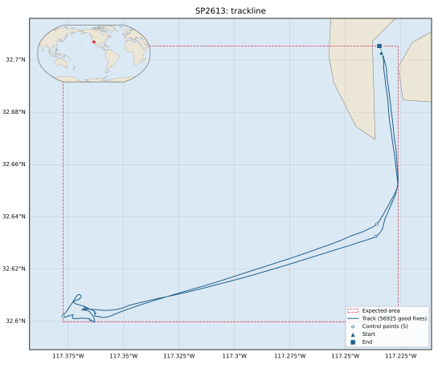

# Example outputs

What nav-qa-processing writes, for one real cruise: **SP2613**, R/V Robert Gordon Sproul, a
day off San Diego on 2026-07-09 (R2R fileset 169851, a Trimble BX992, format nav29, 56,925
fixes at 2 Hz).

| Directory | Command | Files |
|---|---|---|
| [`run/`](run/) | `run`, the core QA, as the OpenVDM hook writes it | [the PDF report](run/SP2613_qa_report.pdf), the [1min](run/SP2613_1min.geoCSV) and [control](run/SP2613_control.geoCSV) products, and [the trackline map](run/SP2613_plots/track_map.svg) |
| [`r2r/`](r2r/) | `r2r run`, with R2R's tests | [the PDF report](r2r/SP2613_qa_report.pdf) with R2R's certificate after the title block, and the R2R QA 2.0 XML |

Left out for size or because they hold local paths: the bestres product (4.4 MB, every fix),
the other three figures (they're in the PDFs) and the notebooks.



## Rebuilding them

From a clone, after a change to the reports (SP2613's fileset is committed in `tests/data/`):

```bash
[ -d data/SP2613_169851_gnss ] || tar -xJf tests/data/SP2613_169851_gnss.tar.xz -C data
uv run nav-qa-processing fetch-map-data   # the map's coastlines
rm -rf output/examples
uv run nav-qa-processing run data/SP2613_169851_gnss -c tests/configs/SP2613_169851.toml -o output/examples/run
uv run nav-qa-processing r2r run tests/configs/SP2613_169851.toml data/SP2613_169851_gnss -o output/examples/r2r
rm -f docs/examples/r2r/*.xml
cp output/examples/run/SP2613_{qa_report.pdf,1min.geoCSV,control.geoCSV} docs/examples/run/
cp output/examples/run/SP2613_plots/track_map.svg docs/examples/run/SP2613_plots/
cp output/examples/r2r/SP2613_qa_report.pdf output/examples/r2r/SP2613_169851_qa.2.0.*.xml docs/examples/r2r/
```

Run them from the repository's root, so the reports name the fileset by its relative path,
`data/SP2613_169851_gnss`.
